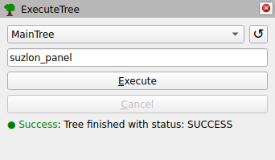

# nxtgen_rviz_behaviortree

## Overview 

This package exposes an RViz2 plugin for executing behavior trees with the [BehaviorTree.ROS2](https://github.com/BehaviorTree/BehaviorTree.ROS2) framework.



**Authors: Thomas Hettasch ([SAM XL](https://samxl.tudelftcampus.nl/))**

**Maintainers: Thomas Hettasch, T.Hettasch@tudelft.nl**

This package has been developed and tested under **ROS2 Jazzy** and **Ubuntu 24.04 (noble)**.

## Installation

### Building
To build from source, clone the lastest version from this repository into your workspace.

Install the dependencies of the cloned packages using `rosdep`:

```bash
cd ros_ws/src
rosdep install --from-paths . --ignore-src -y
```

Finally, build all packages in the workspace:

```bash
colcon build
```

## Usage

Open RViz2, then select `Panels -> Add New Panel`. Select the `ExecuteTree` plugin from the `nxtgen_rviz_behaviortree` folder and press `OK` (the panel name can be optionally changed before pressing `OK`).

If no trees are shown (and most UI elements are greyed out), press the refresh button (circular arrow) in the top right to load the list of all trees from the server. Then select a tree from the dropdown list. A payload may be specified in the text box below the dropdown. To start executing the tree, use the Execute button or the `<Alt> + E` shortcut. Once the tree is running, status information should be shown below the buttons. To cancel the executed tree (while it is still executing), use the Cancel button or the `<Alt> + C` shortcut. If the behavior tree server crashes while a tree is running (and thus the Cancel button does not work), the refresh button can be used to make the dropdown and execute buttons useable again (assuming that the behavior tree server has been restarted).

Default payloads can be configured in the `*.rviz` configuration file. This is done using a `Payloads` list in the panel configuration. The default tree and payload can also be specified (optional). For example:

```yaml
Panels:
  - Class: nxtgen_rviz_behaviortree/ExecuteTree
    DefaultPayload: suzlon_panel
    DefaultTree: Scan
    Name: ExecuteTree
    Payloads:
      - welded_panel
      - suzlon_panel
      - ur16e/welded_panel
      - ur16e/suzlon_panel
```

#### Action Clients

* `/behavior_server` ([btcpp_ros2_interfaces/action/ExecuteTree](https://github.com/BehaviorTree/BehaviorTree.ROS2/blob/6c6aa078ee7bc52fec98984bed4964556abf5beb/btcpp_ros2_interfaces/action/ExecuteTree.action))\
The behavior tree action server with which to interact.
